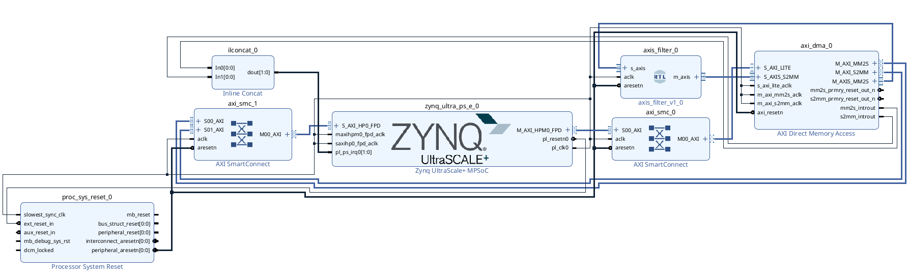

# Design Creation Prototype

**Category:** Design Capture
Hardware-spec-driven block design assembly — the AI implements, the engineer specifies.

## Overview

This example demonstrates a **spec-driven design creation** workflow: you write a hardware specification and provide custom RTL — then a single prompt builds the entire Vivado project, block design, and bitstream from scratch.

The target design is a **DMA loopback via DDR** on the AMD AUP-ZU3. Data is written to DDR by the CPU, transferred through AXI DMA and a custom AXI-Stream filter, and written back to a different DDR region. Verification uses PYNQ — no external I/O, no PMOD required.

## What's Included

```
Lab2/
├── spec/
│   └── hardware_spec.md        # Hardware specification (engineer-authored)
├── src/
│   └── axis_filter.v           # Custom AXI-Stream passthrough filter (28 lines)
├── pynq/
│   └── dma_loopback_ddr.ipynb  # Verification PYNQ example
└── prompts.md                  # Full prompt library
```

**The AI generates everything else** — Vivado project, block design, connection automation, HDL wrapper, synthesis, implementation, and bitstream.

## Step-by-Step Instructions

### Step 1 — Open the example

Open the `Lab2/` folder as your workspace in VS Code or Cursor.

### Step 2 — Verify MCP server is configured

Make sure your MCP configuration points to the Vivado MCP server.

### Step 3 — Run the build prompt

Open your AI agent chat and paste this prompt:

```
Create a Vivado block design for the AUP-ZU3 according to the hardware
specification in spec/hardware_spec.md.
Add the custom RTL module from src/axis_filter.v as a module reference.
Build through bitstream and report timing.
```

The agent reads the spec and autonomously:

1. Creates a Vivado project targeting `xczu3eg-sfvc784-2-e` with the AUP-ZU3 board preset
2. Builds the IPI block design — instantiates IPs, configures parameters, runs connection automation
3. Adds `axis_filter.v` as a module reference in the AXI-Stream data path
4. Assigns the address map, validates the design
5. Generates the HDL wrapper
6. Runs synthesis, implementation, and writes the bitstream

### Step 4 — Review results

The agent produces a block design like this:



**IP components:**

- **Zynq UltraScale+ PS** — board preset applied, M_AXI_HPM0_FPD and S_AXI_HP0_FPD enabled, pl_clk0 @ 100 MHz
- **AXI DMA** — 32-bit data, simple mode (no scatter-gather), DRE enabled
- **axis_filter** — your custom RTL module reference in the MM2S → S2MM loopback path
- **AXI SmartConnect0** — 1 SI × 1 MI (PS → DMA regs)
- **AXI SmartConnect1** — 2 SI × 1 MI (DMA masters → PS DDR)
- **Concat** — aggregates DMA interrupts → `pl_ps_irq0`

**Address map:**

| Peripheral | Base Address | Size | Accessed By |
|------------|-------------|------|-------------|
| PS S_AXI_HP0_FPD | `0x0000_0000` | 2 GB | DMA MM2S + DMA S2MM |

| Peripheral | Base Address | Size | Accessed By |
|------------|-------------|------|-------------|
| AXI DMA | `0xA000_0000` | 64 KB | CPU only |

**Expected timing (AUP-ZU3 @ 100 MHz):**

| Metric | Value |
|--------|-------|
| WNS | +6.885 ns |
| WHS | +0.010 ns |
| Errors | 0 |
| Critical Warnings | 0 |

### Step 5 — Load bitstream on AUP-ZU3 through PYNQ Jupyter Notebook

- `design_1_wrapper.bit`  — the bitstream
- `design_1_wrapper.hwh`  — the hardware hand-off metadata

copy files in this `pynq/` folder:

```bash
cp vivado/aup_zu3_dma.runs/impl_1/design_1_wrapper.bit                     pynq/design_1_wrapper.bit
cp vivado/aup_zu3_dma.gen/sources_1/bd/design_1/hw_handoff/design_1.hwh    pynq/design_1_wrapper.hwh
```

Copy the `.bit.hwh.ipynb` to the board:
- Open browser and connect board through http://192.168.3.1:9090
- Password: xilinx
- Create new folder
- Upload`.bit.hwh.ipynb` to new folder

### Step 6 — Verify DMA loopback on hardware

You can also ask the agent to generate a verification notbook by pasting this prompt:

```
Provide a PYNQ jupyter notebook example to test DMA loopback through DDR.
And wirte markdown description in notebook.
```

Or run pynq/dma_loopback_ddr.ipynb

If the readback values match, the full data path is verified: CPU → DDR → DMA MM2S → `axis_filter` → DMA S2MM → DDR → CPU.


## What You'll Learn

- How a **hardware specification drives AI design creation** — you define what IPs, parameters, and address maps you want; the agent translates that into the right sequence of Tcl commands
- How a single prompt handles the full flow: project creation → IP instantiation → connection automation → address assignment → synthesis → implementation → bitstream
- How **spec quality determines output quality** — explicit IP parameters, address maps, and data path descriptions produce a bitstream that works on first silicon with no manual fixups

!!! note "Scope: Standard IPs Only"
    This example uses **well-documented, standard IPs** (AXI DMA)
    whose parameters are straightforward and have no complex interdependencies. A precise
    hardware spec is sufficient for the AI to configure them correctly on the first attempt.

    For designs that use **complex IPs** — such as MRMAC, CMAC, XDMA, Versal CIPS, or DDR4
    MIG — this spec-only approach is **not recommended**. These IPs have encrypted validation
    logic, device-specific GT quad locations, and deeply interdependent parameters that cannot
    be reliably inferred from documentation alone. AMD is investigating development of
    scalable **IP Configurator** and **IP Connectivity** skills to address these complex IPs
    in a future release.

<p class="sphinxhide" align="center"><sub>Copyright © 2026 Advanced Micro Devices, Inc</sub></p>
<p class="sphinxhide" align="center"><sup><a href="https://www.amd.com/en/corporate/copyright">Terms and Conditions</a></sup></p>
